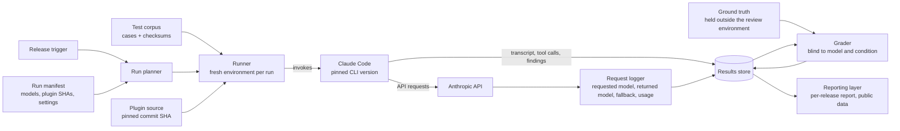

# 03 Architecture

This document names the components and their contracts. It does not choose the implementation language, repository layout, or storage technology; those are open decisions (document 07).

## Diagram

## Components

1. **Test corpus.** A versioned set of cases. Each case has an identifier, the code to review, and a checksum. The corpus has a version and a checksum over all cases. Ground truth is stored separately and is never present in the environment where the review runs.
2. **Run planner.** Expands a run manifest into the list of runs: every cell (model, plugin condition, case) times the number of repeats. It randomises execution order so that time-of-day and service effects do not line up with one model.
3. **Runner.** For each run: creates a fresh environment, installs the pinned Claude Code version, installs the plugin from the pinned commit (or no plugin for the baseline), places the case, invokes the review with the specified model and explicit effort setting, and collects output. It verifies checksums of the corpus case and the installed plugin files before invoking.
4. **Request logger.** Records, for every API request in a run: timestamp, requested model, returned model, whether a fallback occurred, effort and thinking settings in force, input and output token counts, stop reason, latency, and request identifier. Where the logger sits (proxy, Claude Code's own telemetry, or transcript parsing) is an open decision. It must capture requests made by subagents as well as the main session.
5. **Grader.** Takes the normalised findings of a run and the ground truth for that case and produces, per finding, a match or no-match, and per planted defect, detected or missed. It receives findings with model and plugin condition removed. The grading method is an open decision.
6. **Results store.** Append-only. Holds raw artifacts (transcripts, tool calls, request logs), normalised findings, grades, and run metadata. Raw artifacts are never rewritten; regrading adds a new grade record with a grader version.
7. **Reporting layer.** Produces the per-release report (pass, regression, or inconclusive per metric), cost tables, fallback counts, and the public result bundle.

## Data flow

1. A trigger (new model release or manual) creates a run manifest.
2. The planner expands it and assigns run identifiers.
3. The runner executes each run in isolation and writes raw artifacts and metadata.
4. The logger's records are joined to the run by run identifier.
5. A normalisation step extracts findings into the common schema.
6. The grader scores findings against ground truth.
7. The reporting layer aggregates by cell and compares with stored results of earlier releases.

## Run identifier scheme

Every run has a unique identifier that either encodes or maps one-to-one to:

- campaign identifier (one campaign per trigger),
- corpus version and case identifier,
- requested model identifier,
- plugin condition: the commit SHA (short form in the identifier, full form in metadata) or `baseline`,
- repeat index,
- attempt index (incremented on harness retry; see TR-14).

Illustrative shape only: `<campaign>.<corpus-version>.<case>.<model-id>.<plugin-sha-or-baseline>.r<repeat>.a<attempt>`. The identifier contains the requested model, never the returned model; the returned model lives in the request log. Identifiers contain no secrets and no personal information.

## Reproducibility

A run is reproducible when a third party can re-create its inputs exactly. Model output is not deterministic, so the claim is "same inputs and procedure", not "same output". Each run's metadata must record:

- full plugin commit SHA and a checksum of the installed plugin tree,
- exact model identifier requested (a dated or versioned identifier, not an alias),
- Claude Code CLI version, and the environment image digest,
- every setting passed: effort, thinking configuration, permission mode, tool allowances, timeouts,
- the exact invocation (command and prompt text),
- corpus version and case checksum,
- harness version (its own commit SHA), grader version, and schema version,
- start and end timestamps in UTC.

The environment must contain no user-level Claude Code configuration, memory files, other plugins, or prior session state. Network access is limited to what the run needs. The run manifest, pre-registration file, and all metadata are published with the results.
