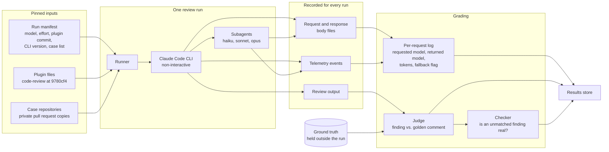
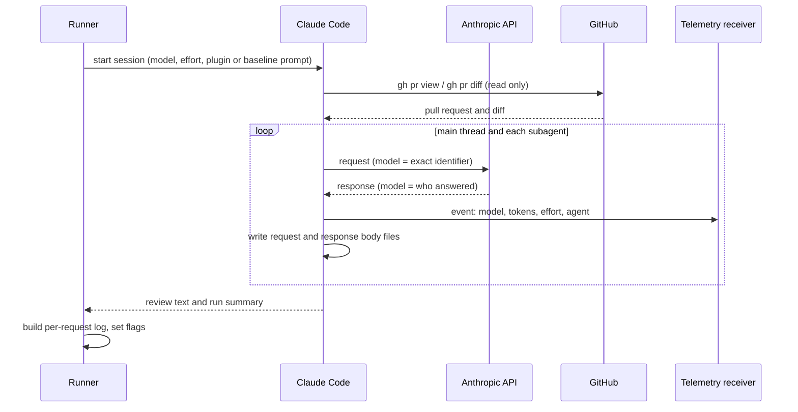

# Architecture

FrontierEval is deliberately small. It drives the real Claude Code command-line tool, the way a user would, and wraps it with three things a user does not have: a fixed set of cases, a recorder for every model request, and a grader.

## Components

| Component | Job |
|---|---|
| **Run manifest** | States everything that defines a run: exact model identifier, effort level, plugin commit, Claude Code version, case, arm, repeat number. A campaign is a list of manifests. |
| **Runner** | Starts one Claude Code session per manifest in a fresh configuration directory, with a budget cap, and collects what it produces. |
| **Claude Code CLI** | The system under test, unmodified. In the plugin arm it loads the plugin from a checked-out commit. In the baseline arm it does not. |
| **Telemetry receiver** | A small local service that Claude Code exports its events to. Nothing sits between Claude Code and the API. |
| **Per-request log** | One record per API request, built by joining body files and events. This is what proves which model did the work. |
| **Judge** | A model that decides whether a reported finding describes the same issue as a ground-truth comment. |
| **Checker** | A model that looks at findings matching no ground-truth comment and decides whether each is a real defect the ground truth missed. |
| **Ground truth** | The benchmark's golden comments. Never placed where a reviewing session can read them. |

## One run, step by step

After the run, the runner checks three things before the output is allowed near a result:

1. **Completeness.** Every request has a request body file, and every successful response has a response body file. If not, the run is a harness failure.
2. **Fallback.** No response came from a model other than the one requested.
3. **On-target.** The main thread asked for the model the manifest names, on every request.

## Design choices worth knowing

**Drive the real tool.** The plugin is a set of instructions to Claude Code. Calling the API directly would test a reimplementation. FrontierEval runs the same binary a user runs.

**Record at the source, not in the path.** A logging proxy between Claude Code and the API would see everything, but it could also change behaviour. Claude Code can write the raw request and response for each call to disk and export events about them. That adds nothing to the request path. A local stand-in for the API was used once, in testing, to confirm the two views agree.

**Every run status is explicit.** A run ends as exactly one of: completed, refused, contaminated by fallback, skipped by the plugin, or harness failure. Only completed runs are scored. The others are counted and reported.

**Fallback is switched off.** By default Claude Code re-runs a flagged request on a different model and carries on. For an evaluation that is contamination. With fallback disabled, a flagged request ends the run with a refused status.

**Fresh environment per run.** Each run gets its own configuration directory. No memory, settings, or session history carries over.

## What is pinned

| Thing | Pinned to |
|---|---|
| Models | `claude-opus-5-5`, `claude-fable-5-2` |
| Effort | `high`, set explicitly |
| Plugin | `anthropics/claude-plugins-official`, `plugins/code-review`, commit `9780cf4`, verified by file hash |
| Claude Code | v2.1.325, verified by binary hash |
| Benchmark | `withmartian/code-review-benchmark` at commit `e616e84`, golden files verified by hash |
| Case order | A seeded shuffle fixed before any run |
