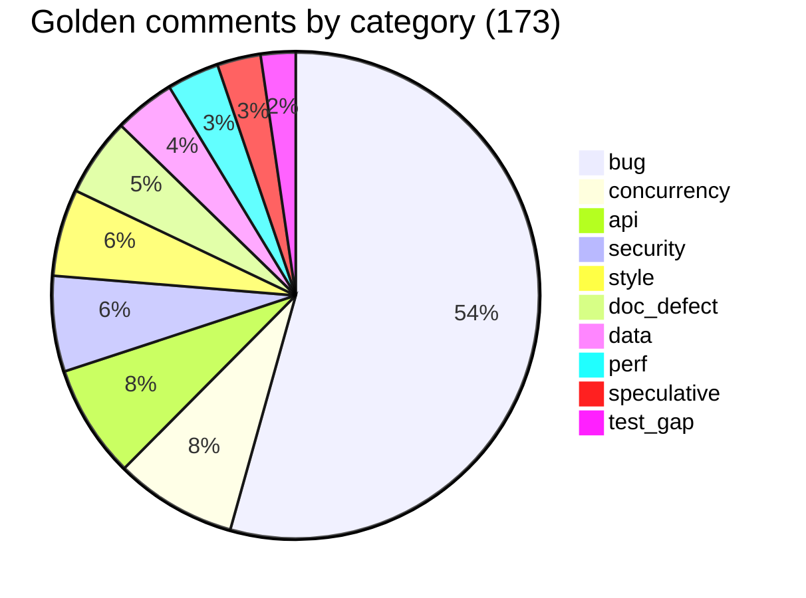
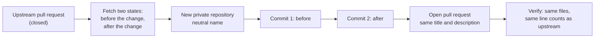

# Corpus

## The choice

FrontierEval uses the offline set from the [Martian Code Review Bench](https://github.com/withmartian/code-review-benchmark): 50 real pull requests from five open-source projects, with 173 human-curated "golden comments" describing real issues in them. The benchmark's code and data are MIT-licensed.

The alternative was to write our own cases and plant our own bugs. Reusing an existing benchmark means the ground truth was produced by someone else, and the numbers can be set beside published ones.

## What is in it

| | |
|---|---|
| Pull requests | 50, ten from each project |
| Projects | Sentry, Grafana, Cal.com, Discourse, Keycloak |
| Golden comments | 173 |
| Per pull request | 1 to 9, median 3 |
| Each golden comment has | A description, a severity, a category |
| Each golden comment lacks | A file path and a line number |

Severity: 12 critical, 54 high, 61 medium, 46 low.

## Why this one

Several organisations score AI review tools on these same 50 pull requests, which makes it the nearest thing the field has to a shared standard. It also turned out to contain a prior run of the plugin under test: the benchmark's helper script for its "claude" entry instructs the operator to run `/code-review:code-review`.

No benchmark we found met every requirement. The main candidates:

| Benchmark | Strength | Why not first |
|---|---|---|
| **Martian offline** (chosen) | Shared across vendors, real pull requests, prior Claude results | No clean cases, public answers, no line-level truth |
| GitHub ReviewBench | Largest and most diverse | Could not confirm the data is downloadable |
| AACR-Bench | File and line ranges in the ground truth | No published Claude results |
| SWR-Bench | 500 clean pull requests | Python only, no line-level truth |
| Bug-fix datasets (Defects4J, SWE-bench) | Well known | Built for fixing, not reviewing, and heavily exposed to training |
| Security suites (Juliet, OWASP) | Planted, exact ground truth | The plugin is told not to flag general security issues |

Figures for the alternatives came from web research and were not all checked at source.

## Its limits

These are stated wherever results appear.

- **The answers are public.** The benchmark's own README says tools may have seen the pull requests in training.
- **There are no clean cases.** Every pull request has at least one known issue, so the false-alarm rate on a correct change cannot be measured.
- **The golden set is incomplete.** A correct finding that reviewers did not write down counts against precision.
- **Matching needs a judge.** With no file or line in the ground truth, a model decides whether a finding and a golden comment describe the same issue.

## How cases are prepared

The original pull requests are closed, and the plugin skips closed pull requests. Each case is therefore re-created as a fresh, open pull request in a private repository.

This differs from the benchmark's own script in four ways, each on purpose:

| | Benchmark's script | FrontierEval |
|---|---|---|
| History | Full upstream history | Two commits. The diff is identical. |
| Visibility | Public | Private |
| Repository name | Names the project and pull request | Neutral |
| Mentions in the description | Left as written | Neutralised, so nobody is notified |

The trade-off: a two-commit copy has no history to inspect. The plugin version under test has no history-reading agents, so it is unaffected, but this is a departure from the published benchmark and applies to any comparison with its numbers.

## Selecting the 15

Five of the 50 entries carry a maintainer note flagging a problem, and are excluded. The remaining 45 were shuffled within each project using a recorded seed, before any run. The pilot takes the first three from each project. Nobody picked cases by hand.
