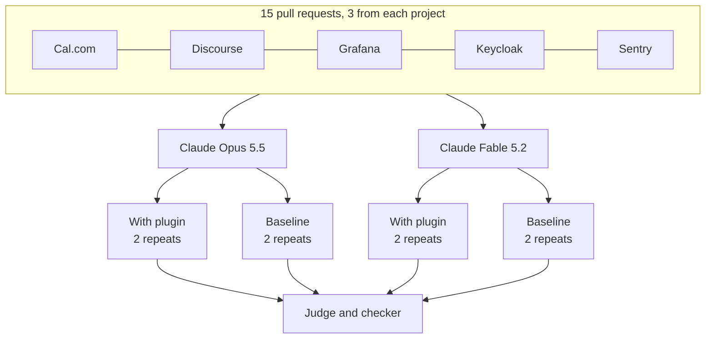

# Experimental Design

*Part of the [Deep Dive](Deep-Dive). Evaluators: start at [For AI Evaluators](For-AI-Evaluators) for the short version.*

## The hypothesis

> **Plugins age badly.** Instructions written for an older model add less value on a newer one, and may hold it back.

## What this pilot tests

The pilot cannot test ageing across many model generations. It tests one step of it.

- The plugin's current instructions were brought into the official plugin repository in October 2026. When they were first written is not recorded.
- Claude Opus 5.5 was released in September 2026, before that. Claude Fable 5.2 was released in November 2026, after it.

**Prediction:** the plugin's advantage over a plain review prompt is smaller on Fable 5.2 than on Opus 5.5.

For each model, "advantage" means the difference between the plugin arm and the baseline arm in finding real defects, weighed against noise, cost, and consistency. Two models make a comparison, not a trend. The pilot is the first data point for the hypothesis, not a verdict on it.

## The design

| Factor | Levels |
|---|---|
| Model | Claude Opus 5.5, Claude Fable 5.2 |
| Arm | With plugin, baseline |
| Case | 15 pull requests |
| Repeat | 2 |
| **Total review runs** | **120** |

Held fixed: effort `high`, the plugin commit, the Claude Code version, tool permissions (read-only in both arms), and the baseline prompt.

### The baseline prompt

> Review pull request #N in this repository. Use the gh CLI to read it. Report every bug or defect you find in the changed code, giving the file path and line for each. Do not post anything to GitHub.

The baseline is a choice, and it shapes the comparison. A prompt that says "report every bug" invites a long list. The plugin is told to report only what it can validate. That difference is part of what is being measured, and readers should keep it in mind.

## What is measured

| Measure | Definition |
|---|---|
| **Recall** | Share of ground-truth issues that a run reported |
| **Precision** | Share of a run's findings that match a ground-truth issue |
| **Confirmed extras** | Findings that match no ground-truth issue but that the checker judges real |
| **Cost** | Tokens and estimated dollars per run, split by model |
| **Variation** | How much the two repeats of the same case disagree |
| **Model use** | Which model served each role in each run |
| **Run status** | Completed, refused, fallback, skipped, or harness failure |

Precision here is a lower bound. The ground truth is known to be incomplete, so an unmatched finding may be correct. The "confirmed extras" measure exists to recover those.

## An important wrinkle: the plugin picks its own models

The plugin's instructions name a model tier for each subagent. In a logged run on Opus 5.5:

| Role | Model that ran |
|---|---|
| Orchestration and final report | Session model |
| Eligibility check, finding guideline files | Haiku 5.5 |
| Pull request summary | Sonnet 5.5 |
| Bug review, two agents | Opus 5.5 |
| Validating each candidate bug | Opus 5.5 |

So the two models under test are not symmetric:

- **Opus 5.5 session.** The plugin's bug reviewers are also Opus 5.5. Plugin and baseline differ in instructions only.
- **Fable 5.2 session.** The baseline review is done by Fable 5.2. The plugin still sends bug review to "Opus". Plugin and baseline differ in instructions *and* in reviewing model.

The plugin is tested as shipped, because that is what users get. Which models actually ran is logged for every request and reported with the results.

## What the pilot can and cannot show

**It can show:**

- Whether the harness produces trustworthy, fully attributed runs.
- The size and direction of the difference between plugin and baseline on these cases.
- How much runs vary, which sets the size of any later study.
- What each arm costs.

**It cannot show:**

- Statistical proof. Fifteen cases is a small sample. No pass or fail thresholds were fixed in advance, so the run is **exploratory**. Results are reported with intervals and described as observations.
- Anything free of training-data leakage. The pull requests and their ground truth are public.
- A trend across model generations. That needs more models and more plugin versions.
- Why any difference arises. On Fable 5.2 the plugin sends bug review to Opus 5.5, so "the instructions suit the newer model less" and "the plugin did not use the newer model" cannot be told apart without a further arm.

## Threats to validity

| Threat | What it does | What we do about it |
|---|---|---|
| Public answers | Models may have seen the cases or the ground truth | Report it. Review sessions have no web access. A leak-free follow-up set is planned. |
| Incomplete ground truth | Real findings count as false positives | Checker for unmatched findings |
| Model-based judge | Judge errors move the scores | One pinned judge, the benchmark's own prompts, a hand-checked sample |
| No clean cases | False-positive rate on a correct change is unmeasured | Stated as a limit. Addressed by the follow-up set. |
| Small sample | Wide intervals | Report intervals. Do not over-read. |
| Model behaviour drifts | Serving infrastructure can change under a fixed identifier | Run each comparison in a short window. Record dates. |
| Baseline wording | A different prompt would give a different baseline | Prompt is fixed, versioned, and published |
