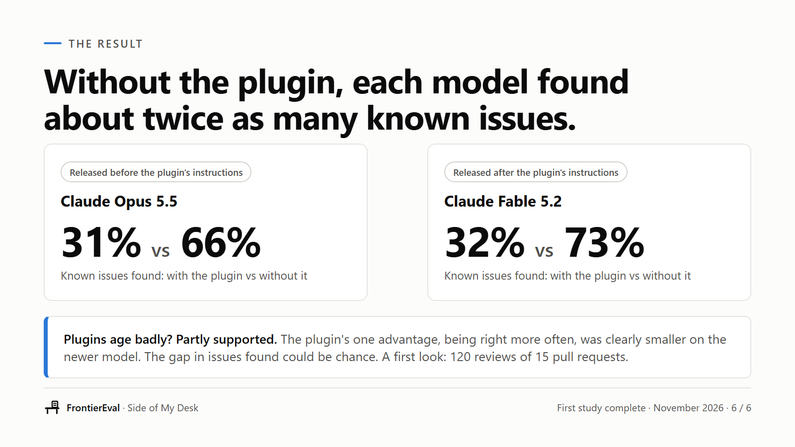

**Six slides, two minutes.** Each slide is a 1600×900 image you can save and drop into your own deck. The bullets beneath each one are the talking points. Click a slide to open the detail behind it.

> **Status (November 2026): the first study is done.** 120 reviews of 15 real pull requests. Slide 6 has the answer, the [Results](Results) page has every chart, and the [paper](https://research.sideofmydesk.com/edition-1/) has the full account. Read it as a first look.

---

- **Coding agents are extended with plugins**, and a plugin is a set of written instructions.
- **Those instructions are written for the models of the day.** Then a new model ships.
- **FrontierEval checks whether the plugin still helps.** Its first subject is the official code-review plugin for Claude Code.

---

- **Hypothesis: plugins age badly.** Instructions written for an older model help less on a newer one, and may hold it back.
- **Teams rarely re-check.** A plugin gets installed, seems to work, and stays through several model generations.
- **We have a natural test.** One of our two models was released after the plugin's current instructions were adopted.

*Detail: [Experimental Design](Experimental-Design)*

---

- **A decision before you upgrade.** When a model ships, know whether to keep, retune, or drop a plugin.
- **Proof of which model did the work.** Quality and cost are attributed to the model that actually answered.
- **A small bill.** The whole first study, 120 reviews with grading, cost about $136.

*Detail: [Learnings and Next Steps](Learnings-and-Next-Steps)*

---

- **Pin.** Fix the exact model, the plugin version, and the tool version.
- **Run twice.** The same real pull requests, once with the plugin and once with a plain request to review.
- **Record.** Log every request: which model answered, how many tokens, any switch to another model.
- **Compare.** Score both against issues that human reviewers already found.

*Detail: [Architecture](Architecture)*

---

- **The plugin picks its own models.** We chose one model for a review. The plugin sent the work to three.
- **The plugin is selective; a plain prompt is thorough.** On one pull request with 6 known issues, the plugin reported 1 and the plain prompt reported 12.
- **The tool did not flag a model switch.** In testing, its own summary credited the model we asked for when a different one answered.
- **The plugin costs more.** About 2.6 times a plain review on the same pull request.

These are observations from set-up runs on one pull request. The scored results are on slide 6.

*Detail: [Early Findings](Early-Findings)*

---

- **Without the plugin, each model found about twice as many of the known issues.** 31% against 66% on Opus 5.5, and 32% against 73% on Fable 5.2.
- **The plugin says little, and is right more often.** About 2 findings per review against about 10, and more of them matched a known issue.
- **The plugin cost about 1.5 times as much per review.**
- **Plugins age badly? Partly supported.** The plugin's one advantage was clearly smaller on the newer model. The gap in issues found could be chance.
- **A first look.** 15 pull requests, one plugin, two models, graded by an AI.

*Detail: [Results](Results)*

---

## Questions to take to your own team

1. Which plugins or custom instructions do our engineers rely on, and when were they last checked against the model we use now?
2. When we upgrade a model, do our plugins use it, or do they name their own?
3. If a request were answered by a different model than the one we selected, would we know?
4. Do we want an AI reviewer that says little and is usually right, or one that says a lot and needs filtering?
5. What would it cost us to answer these with a measurement? Here it was about $136.

## Go deeper

| If you are | Start at | You will find |
|---|---|---|
| **An engineer using AI coding tools** | [Deep Dive: For Engineers](For-Engineers) | How the harness drives Claude Code, how every request is logged, what the plugin does, where the cost goes |
| **An AI evaluation practitioner** | [Deep Dive: For AI Evaluators](For-AI-Evaluators) | The experimental design, the benchmark and its limits, grading, threats to validity |

All pages: [Deep Dive index](Deep-Dive).
