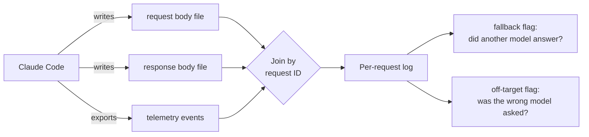

# Request Logging

## The problem

An evaluation that says "model X scored Y" has to know that model X did the work. With an agent that launches subagents, that is not obvious, for three reasons.

1. **The plugin names models for its subagents.** One review run on Opus 5.5 made 32 API requests across three different models.
2. **A flagged request can be answered by a different model.** Current Claude models run safety classifiers. By default, Claude Code re-runs a declined request on another model and continues the session there.
3. **The tool's own summary does not reveal it.** See below.

## What is captured

For every API request, including every subagent request:

| Field | Source |
|---|---|
| Model requested | The request body Claude Code wrote to disk |
| Model that answered | The response body Claude Code wrote to disk |
| Tokens: input, output, cache read, cache write | The response's usage block |
| Effort level | The request body |
| Who made it: main thread or which subagent | Telemetry events |
| Refusal or fallback markers | Response content and telemetry events |

Two flags, because one is not enough. After a fallback, Claude Code keeps the session on the fallback model. Every later request then asks for that model and gets it, so requested and returned match. The second flag compares what was asked against what the run's manifest says should have been asked.

## Proving it before trusting it

The logging was tested in two stages before any scored run.

### Stage 0: against a stand-in, at no cost

Claude Code was pointed at a local program that imitates the API and returns scripted responses. No request reached Anthropic.

| Scripted response | Request file says | Response file says | Claude Code's run summary says |
|---|---|---|---|
| Normal reply | `claude-opus-5-5` | `claude-opus-5-5` | `claude-opus-5-5` |
| Reply from a different model | `claude-opus-5-5` | `claude-opus-4-8` | **`claude-opus-5-5`** |
| Reply with fallback markers | `claude-opus-5-5` | `claude-opus-4-8` | **`claude-opus-5-5`** |
| Refusal, fallback disabled | `claude-opus-5-5` | none written | error, refused |

**The run summary credited the requested model even when another model answered.** Anyone relying on that summary to attribute results would not see a fallback. The body files and the per-request events did record it.

Other things stage 0 established:

- With fallback disabled, a refusal ends the run and Claude Code contacts no other model.
- A refused response is not written to a body file. Refusals have to be read from a dedicated event.
- Printing telemetry to the console produced nothing in an unattended run. Sending it to a small local receiver worked.
- A run with telemetry switched off is detectable, because it leaves no body files.

### Stage 1: real calls

Four small runs on Opus 5.5, about $1.37 in total.

| Check | Result |
|---|---|
| Requested model is the exact identifier | Yes, on every main-thread request |
| A live response reports that identifier | Yes |
| Subagent requests are logged and attributed | Yes, all of them |
| Effort is recorded on every request | Yes, including subagents |
| Per-model totals match Claude Code's summary | Yes, to four decimal places |
| Tier names resolve to visible identifiers | "haiku", "sonnet", "opus" ran as `claude-haiku-5-5`, `claude-sonnet-5-5`, `claude-opus-5-5` |

## What a run costs, and why

One plugin run and one baseline run on the same pull request, on Opus 5.5:

| | Requests | Time | Estimated cost |
|---|---|---|---|
| With plugin | 32 | 114 s | $0.78 |
| Baseline | 8 | 57 s | $0.30 |

Almost none of that is ordinary input tokens. Claude Code caches heavily, so cost is dominated by cache writes and cache reads:

- Every session writes Claude Code's own system prompt to the cache: about 22,000 tokens, roughly $0.11 on Opus 5.5.
- Every subagent does the same with about 16,000 tokens. The plugin launched seven.
- Runs started within a few minutes of each other share a cache, so the cost of a run depends partly on what ran just before it.

A cost estimate built from list prices for input and output tokens would have been badly wrong.

## Settings that make runs comparable

| Setting | Why |
|---|---|
| Exact model identifier | Aliases move. Identifiers do not. |
| Effort set explicitly | Opus 5.5 defaults to `medium`. Fable 5.2 defaults to `high`. Leaving defaults would compare effort, not models. |
| Fallback disabled | A flagged request ends the run instead of switching models |
| No fallback chain configured | Avoids switching on overload |
| Fresh configuration directory | No carry-over between runs |
| Pinned Claude Code version | Telemetry format and alias resolution change between versions |
