# Results

> **First study, November 2026.** 120 reviews of 15 real pull requests: with and without the plugin, on Claude Opus 5.5 and Claude Fable 5.2, twice each. Read it as a first look. The limits are at the bottom of this page and in the [paper](https://research.sideofmydesk.com/edition-1/).

## In short

- **Without the plugin, each model found about twice as many of the known issues.**
- **With the plugin, reviews said far less, and more of what they said matched a known issue.**
- **The plugin cost about 1.5 times as much per review.**
- **"Plugins age badly" got partial support.** The plugin's one advantage was clearly smaller on the newer model. The gap in issues found could be chance.

## 1. Run accounting

| Model | Setup | Completed | Refused |
|---|---|---|---|
| Opus 5.5 | With the plugin | 30 | 0 |
| Opus 5.5 | Without it | 30 | 0 |
| Fable 5.2 | With the plugin | 29 | 1 |
| Fable 5.2 | Without it | 30 | 0 |

No run switched to a fallback model, posted to a pull request, or changed the checked-out code. The one refused run happened when a helper running on Opus 5.5 was stopped by a safety filter while looking at a cross-site scripting issue. It is left out of the scores.

## 2. Known issues found, and how often a finding matched one

| Model | Setup | Known issues found | Findings that matched a known issue | Findings per review | Cost per review |
|---|---|---|---|---|---|
| Opus 5.5 | With the plugin | 31.1% (19.4 to 45.5) | 53.2% (35.7 to 71.3) | 2.1 | $0.60 |
| Opus 5.5 | Without it | 66.0% (54.7 to 78.6) | 21.3% (16.9 to 26.2) | 11.3 | $0.41 |
| Fable 5.2 | With the plugin | 31.6% (19.6 to 44.8) | 43.1% (28.8 to 57.0) | 2.5 | $1.75 |
| Fable 5.2 | Without it | 72.6% (63.0 to 83.3) | 26.5% (21.0 to 32.0) | 10.1 | $1.14 |

The numbers in brackets are 95% ranges, found by resampling the 15 pull requests 10,000 times.

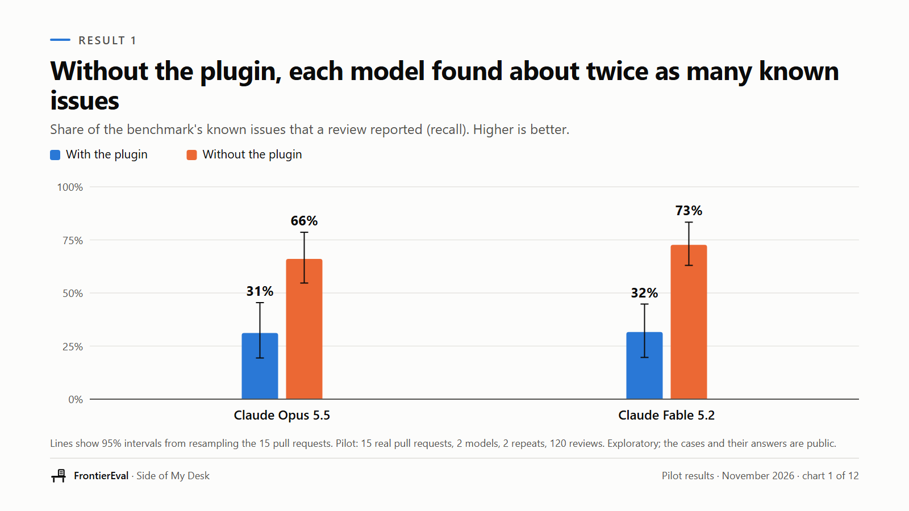

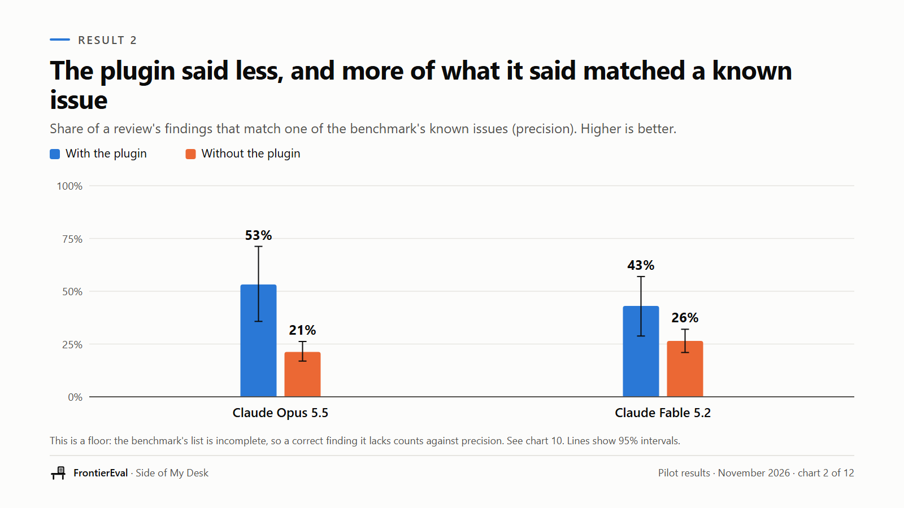

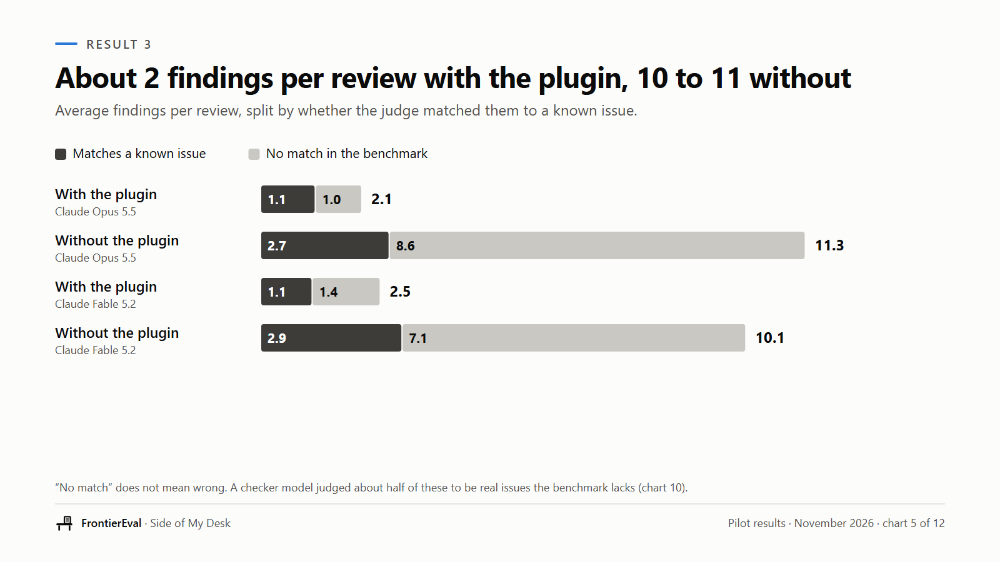

## 3. What the plugin changed, and the hypothesis

| | Opus 5.5 | Fable 5.2 | Difference between models |
|---|---|---|---|
| Known issues found: plugin minus no plugin | −34.9 points | −41.0 points | −6.1 (−14.5 to +3.7): not clear |
| Findings that matched: plugin minus no plugin | +31.9 points | +16.6 points | −15.4 (−30.1 to −3.2): clear |

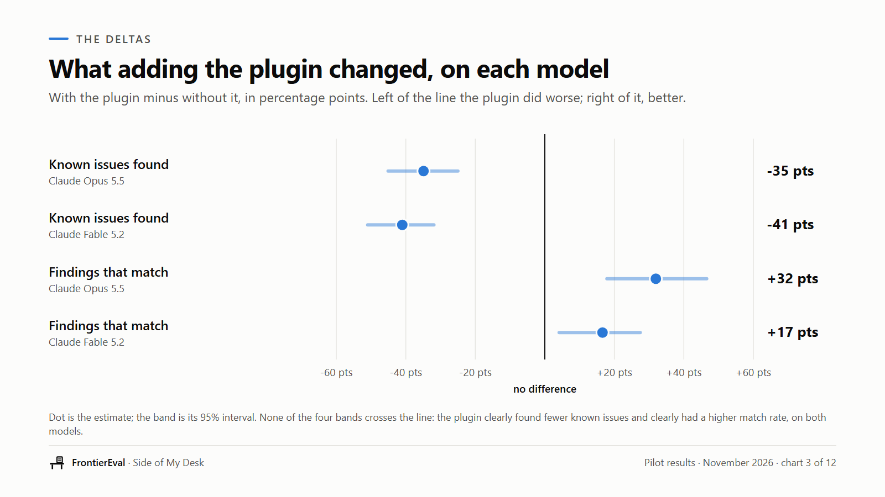

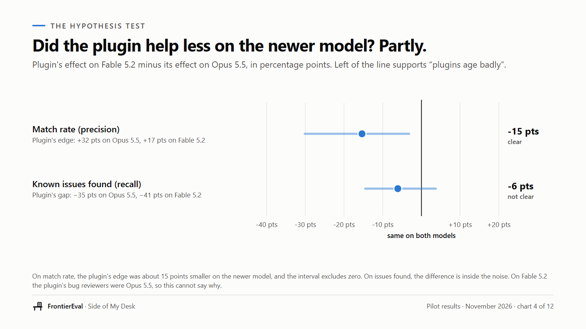

The prediction was that the plugin would help less on the newer model. On the share of findings that matched a known issue, it did, and the range does not include zero. On known issues found, the plugin did worse than no plugin on both models, and the difference between models could be chance. So the idea got some support. It is not proven.

## 4. Pull request by pull request

On none of the 15 pull requests did the plugin find more of the known issues than the simple request, on either model. Each model had two ties.

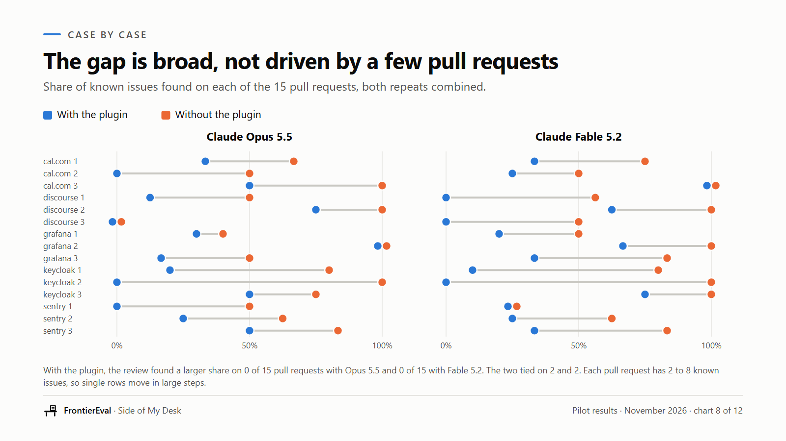

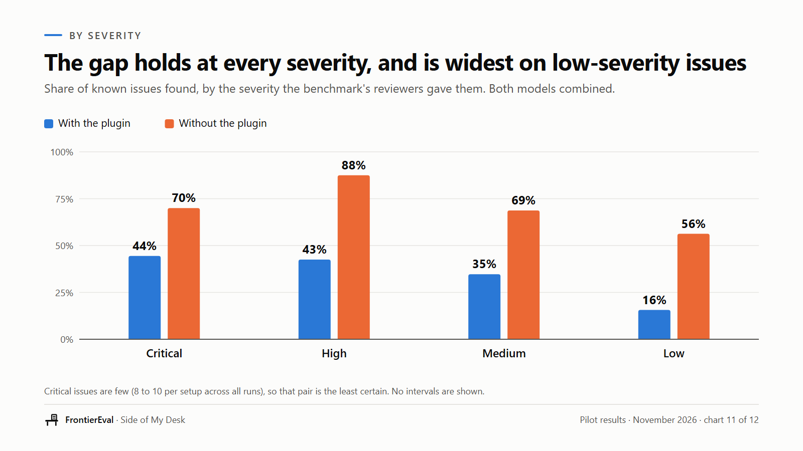

## 5. Consistency

Each pull request was reviewed twice in each setup. Of the known issues found at least once, the share found both times:

| Model | With the plugin | Without it |
|---|---|---|
| Opus 5.5 | 65% | 84% |
| Fable 5.2 | 63% | 83% |

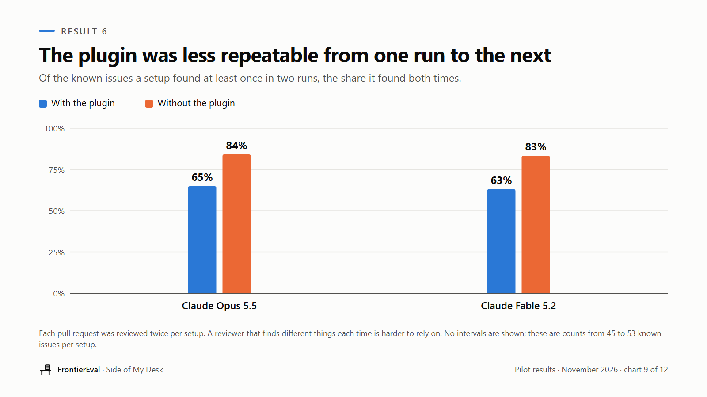

## 6. Cost, and which models did the work

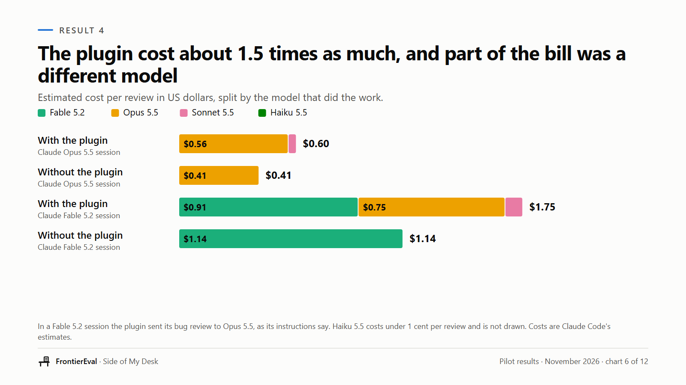

- **The plugin picks its own models.** When Fable 5.2 was chosen, the plugin's bug-hunting helpers still ran on Opus 5.5. That was 43% of the cost of those reviews ($0.75 of $1.75).
- **Opus 5.5 often skipped the plugin's process.** In 13 of 30 plugin reviews it started no helpers and did the work alone. Those reviews cost $0.28 against $0.85, and found about as many known issues (29.5% against 32.3%).
- **Fable 5.2 started helpers every time.**

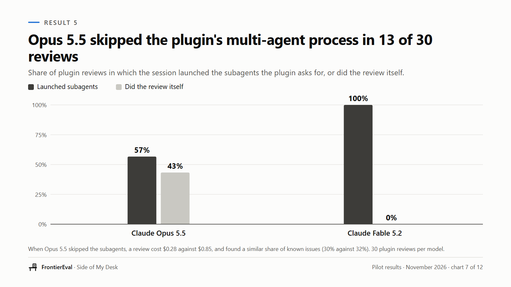

## 7. Findings outside the test set

The reviews reported 543 findings that matched no known issue. A checker model looked at every one.

| Checker's verdict | Findings |
|---|---|
| Real | 285 |
| Not real | 136 |
| Cannot tell | 122 |

The 285 "real" findings come to **123 separate issues** that the test set does not list. The test set lists 53 for these pull requests. Reviews without the plugin found 118 of the 123; reviews with it found 24.

A second, more careful review looked again at 30 of the checker's verdicts without seeing them. It agreed on 24 (16 of 20 "real", 8 of 10 "not real"). So the true number is probably somewhat lower than 123. Both reviews were done by AI models. No person checked either.

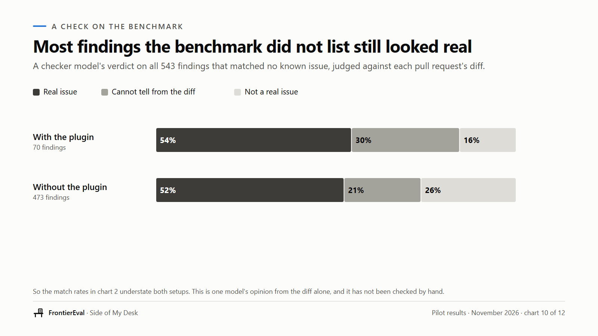

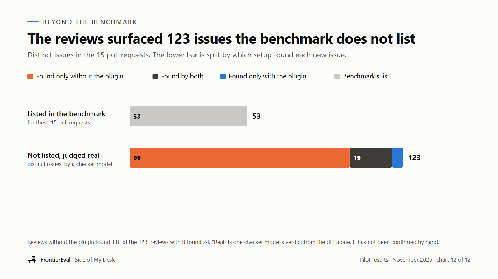

This matters for reading section 2. A "finding that matched no known issue" is not the same as a wrong finding. The low matching rate without the plugin partly reflects a test set that is missing issues.

## What this study cannot show

- **It is small.** 15 pull requests, one plugin, two models. The ranges are wide.
- **The test set is public.** The models may have seen the pull requests and the answers.
- **An AI did the grading.** No person checked the judge or the checker.
- **No pass marks were set ahead of time.** This is a first look, and it should be read as one.
- **The pull requests were copies**, squashed to two commits, so the plugin could not look at history as it would in real use.
- **One wording of the simple request was used.** A different wording could move the result.
- **Two models are two points.** They cannot show a trend over time.

The paper's section "What this study cannot show" says more.

## Files

- [`results/pilot-1/runs.csv`](https://github.com/sideofmydesk/frontier-eval/blob/main/results/pilot-1/runs.csv): one row per review.
- [`results/pilot-1/summary.json`](https://github.com/sideofmydesk/frontier-eval/blob/main/results/pilot-1/summary.json): every number on this page.
- [The paper (PDF)](https://research.sideofmydesk.com/edition-1/michel-2026-code-review-plugin.pdf).
